


✉️ <code>sharvilprabhudesai15@gmail.com</code>




  <a href="https://github.com/sharvilprabhudesai15/chargeatlas-nsw"></a>
  <a href="https://sharvilprabhudesai.com/projects/ideajoust/"></a>

  <a href="https://sharvilprabhudesai.com/projects/wakeline/"></a>
  <a href="https://sharvilprabhudesai.com/projects/tracelens/"></a>

  <a href="https://sharvilprabhudesai.com/projects/flight-delay-prediction/"></a>
  <a href="https://sharvilprabhudesai.com/projects/price-insights-recommendations/"></a>

Cards marked <b>CASE STUDY</b> open a write-up on my portfolio — their code is private and available on request.


  <a href="https://github.com/sharvilprabhudesai15/Artificial-Intelligence-Basics"></a>
  <a href="https://github.com/sharvilprabhudesai15/Operating-System-Algorithms"></a>
  <a href="https://github.com/sharvilprabhudesai15/Modern-Algorithms-Strategies"></a>

  


<a href="https://doi.org/10.1109/IDCIoT59759.2024.10467802"></a>

📄 <a href="https://doi.org/10.1109/IDCIoT59759.2024.10467802"><i>Survey on Recommendation System Combining Hybrid and Popularity Based Approach</i></a> — IEEE IDCIoT 2024 🏅 Best Student Award, 2024 graduating cohort · Second rank in third and final year

